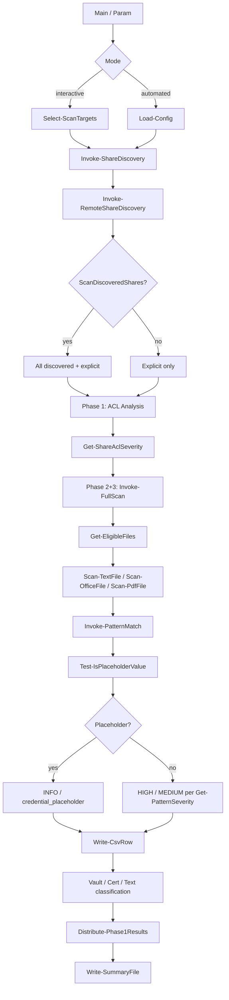
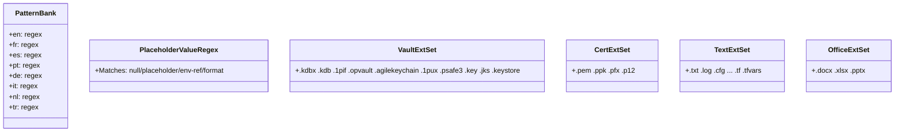
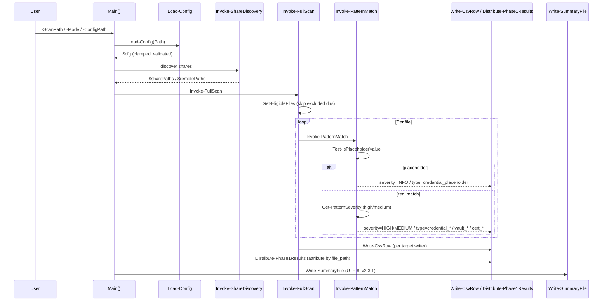
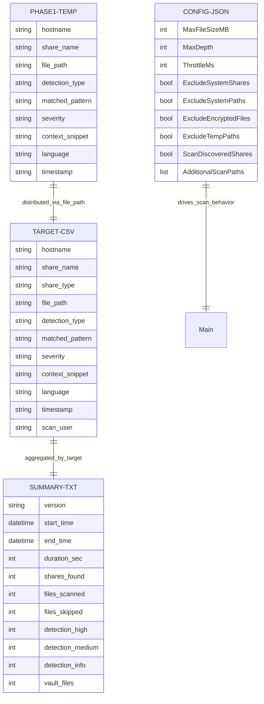

# GAP07 — Credential Exposure Audit Platform (WIKI)

## 1. Project Overview

- **Project:** `GAP07` / `scan_credentials_v6.ps1`
- **Language:** PowerShell (Windows, pure PowerShell — zero external dependencies)
- **Purpose:** Audit Windows file-server shares for exposed credentials (cleartext regex matches), vault/key files, and open-share ACL risks.
- **Version:** `v2.3.1` (upgraded from `v2.1.0` baseline in `backup/`)
- **Modes:** `interactive` (discover → pick targets → scan) and `automated` (Ansible/headless)
- **Output:** Per-target `1_open_shares.csv`, `2_credentials.csv`, `3_vaultfiles.csv` + `summary.txt`
- **Key source of truth:** `Get-ShareAclSeverity` (shared severity classifier)

## 2. Architecture



## 3. Project Structure

```
C:\projects\GAP07
├── scan_credentials_v6.ps1     # current (v2.3.1, edited — 1377 lines)
├── backup/
│   └── scan_credentials.ps1     # original baseline (v2.1.0 — 982 lines)
├── WIKI.md                      # this file
└── .phase1_temp.csv             # temp (generated at runtime)
```

Excluded from traversal (hard-coded): `Windows`, `Program Files`, `$Recycle.Bin`, `System Volume Information`, `AppData`, `Temp`, hidden/system files, EFS-encrypted, `.tmp`/`.bak`.

## 4. Core Components

### 4.1 Helper Functions (source of truth / security)

| Function | Role | Key behavior |
|---|---|---|
| `Get-ShareAclSeverity` | **Shared ACL severity source of truth** | Classifies `Allow` access using specific Write/Delete bits (HIGH) and Read (MEDIUM), rejecting `Modify` treated as `Read` superset |
| `Test-PathUnderTarget` | Attribution boundary check | Path-boundary-aware containment (not `IndexOf`); prevents `C:\DataArchive\file.txt` from being swallowed by `C:\Data` |
| `Get-CsvFieldValue` | CSV parsing (RFC-4180) | Field-extraction by index; handles quoted commas / doubled quotes |
| `Escape-CsvField` | CSV / formula-injection guard | Prefixes `=+-@\t\r` with `'`; then quotes if contains `,"\r\n` |
| `Load-Config` | Config loader | Throws on missing file; clamps numeric values (`[Math]::Max/Min`); supports snake_case aliases (`exclude_system_shares`) |
| `Sanitize-TargetName` | Safe filename for outputs | Prevents path-injection in per-target CSV directory names |

### 4.2 Phase Functions

| Phase | Function | Purpose |
|---|---|---|
| 1 (Discovery) | `Invoke-ShareDiscovery`, `Invoke-RemoteShareDiscovery`, `Select-ScanTargets` | SMB / UNC path enumeration + interactive picker |
| 1 (ACL) | `Get-Acl` + `Get-ShareAclSeverity` | Per-share filesystem ACL classification |
| 1 (Distribution) | `Distribute-Phase1Results`, `Initialize-Phase1Buffer`, `Write-Phase1Row` | Match buffered rows to targets by `file_path`; write to `.phase1_temp.csv` |
| 2+3 (Scan) | `Invoke-FullScan` | Single traversal; progress bars (Id 1 overall, Id 2 per-target) |
| 2+3 (Enumeration) | `Get-EligibleFiles` | Raw `.NET` `DirectoryInfo.EnumerateFiles` with depth-bound, reparse-point skip |
| 2+3 (Text) | `Scan-TextFile`, `Scan-OfficeFile`, `Scan-PdfFile` | Regex multilingual (`en/fr/es/pt/de/it/nl/tr`) + PDF text extraction |
| 2+3 (Pattern) | `Invoke-PatternMatch` | Matches per-language model; applies `PlaceholderValueRegex`; writes CSV |

### 4.3 Pattern / Detection Model



## 5. Data Flow



## 6. Data Model



## 7. API Reference (Script Interface)

**Parameters (`Param` block):**

| Param | Default | Type | Purpose |
|---|---|---|---|
| `Mode` | `automated` | `string` | `interactive` / `automated` |
| `ConfigPath` | `''` | `string` | JSON config file |
| `OutputPath` | `''` | `string` | Output directory (default: `WinAuditReport_...`) |
| `Hostname` | `$env:COMPUTERNAME` | `string` | Host label in CSV |
| `ScanPath` | `@()` | `string[]` | Explicit paths to scan |

**Public helper signatures:**

```powershell
function Get-ShareAclSeverity (-Access, -BroadPatterns) → string  # HIGH / MEDIUM / INFO
function Test-PathUnderTarget (-FilePath, -Target) → bool
function Get-CsvFieldValue (-Line, -Index) → string | $null
function Escape-CsvField (-Value) → string  # CSV-safe + formula-guarded
function Load-Config (-Path) → hashtable  # throws if missing / clamps if bad
function Write-CsvRow (-Writer, -Row) → void
```

## 8. Configuration

**File:** `.json` (example from `Load-Config` usage)

```json
{
  "MaxFileSizeMB": 50,
  "MaxDepth": 10,
  "ThrottleMs": 5,
  "AdditionalScanPaths": ["C:\\Data"],
  "ExcludeSystemShares": true,
  "ExcludeSystemPaths": true,
  "ExcludeEncryptedFiles": true,
  "ExcludeTempPaths": true,
  "ScanDiscoveredShares": false
}
```

**Aliases supported:** `exclude_system_shares`, `max_file_size_mb`, `max_depth`, etc.

**Validation rules (post-Phase 2 fixes):**
- Missing path → `throw`
- Numeric values clamped to `[1, 4096]`, `[1, 64]`, `[0, 60000]`
- Boolean aliases mapped correctly

## 9. Getting Started

```powershell
# Automated (no interaction)
.\scan_credentials_v6.ps1 -Mode automated -ScanPath C:\Data -ConfigPath .\config.json

# Interactive (discover shares, pick targets)
.\scan_credentials_v6.ps1 -Mode interactive -OutputPath .\results

# Verify parse / syntax (no execution)
# (Use Parser::ParseFile as documented in session history)
```

**Output per target (`$OutputDir/$SanitizedTarget/`):**
- `1_open_shares.csv`
- `2_credentials.csv`
- `3_vaultfiles.csv`
- `summary.txt`

## 10. Development Guide

- **TDD cycle:** Tests-first per finding (RED/GREEN) — used for 23 findings across 5 phases.
- **Source of truth:** `Get-ShareAclSeverity` — do not inline bit-tests elsewhere.
- **Immutability:** All updates use spread / new objects (e.g., `$cfg = $DefaultConfig.Clone()`); no mutation of shared `$Script:Stats` except via explicit increments.
- **Security rules (from `security-review` / `coding-standards`):**
  - No secrets hardcoded; all via env/config.
  - All SQL/file operations parameterized / boundary-checked (`Test-PathUnderTarget`).
  - CSV injection neutralized (`Escape-CsvField` formula-prefix + quoting).
  - Rate limiting / throttle enforced (`ThrottleMs`, progress-bar throttling).
- **Verification loop:** Build / type-check (`ParseFile`) / lint / tests / security grep / diff review after each phase.

---

*Document version: 1.0 (matches script v2.3.1). Generated for GAP07 repo after Phase 1–5 remediation (23 findings remediated, `Get-ShareAclSeverity` established as shared source of truth).*
